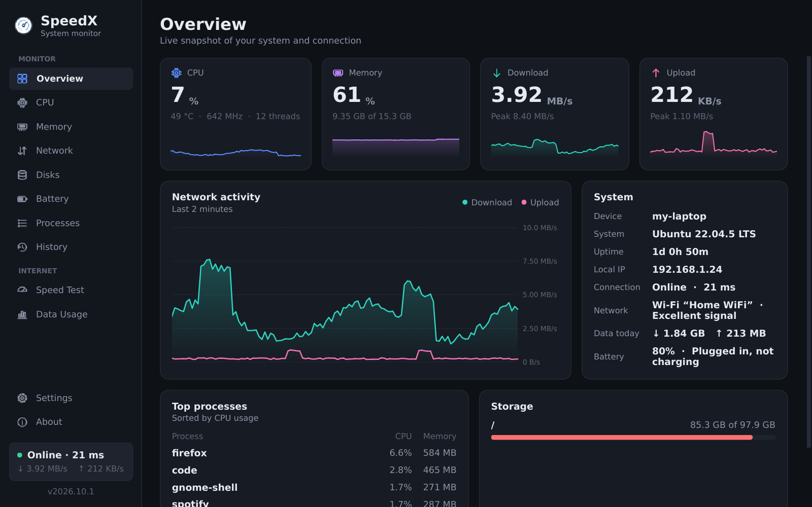
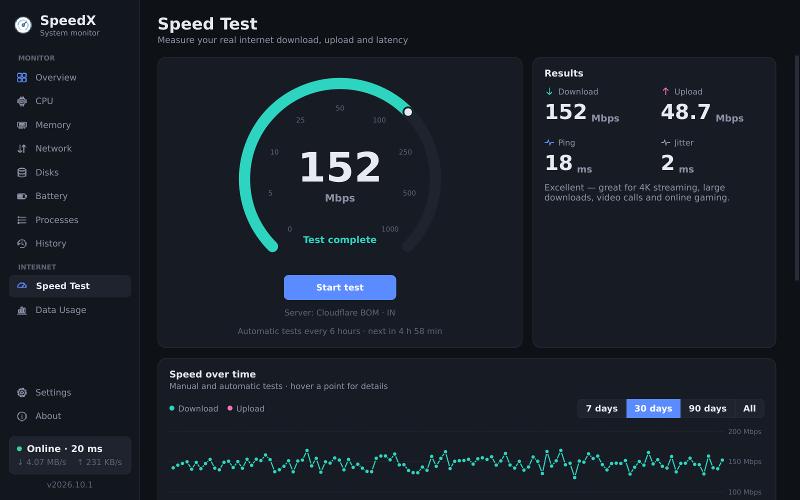
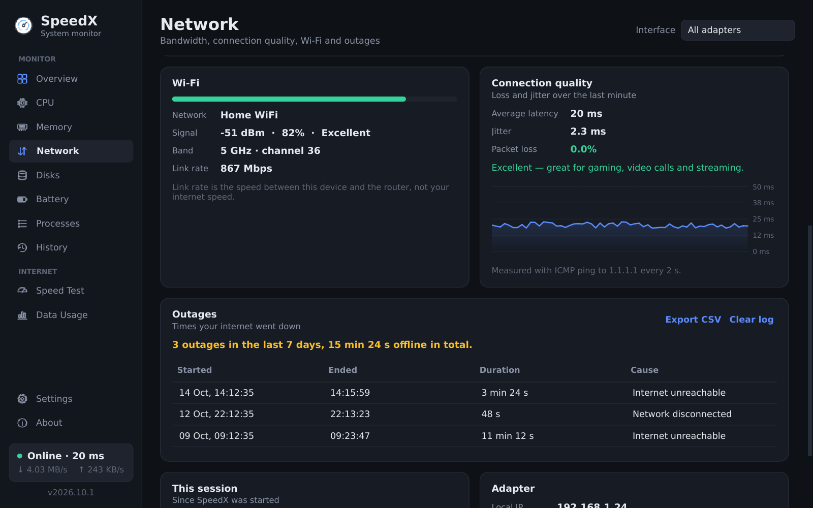
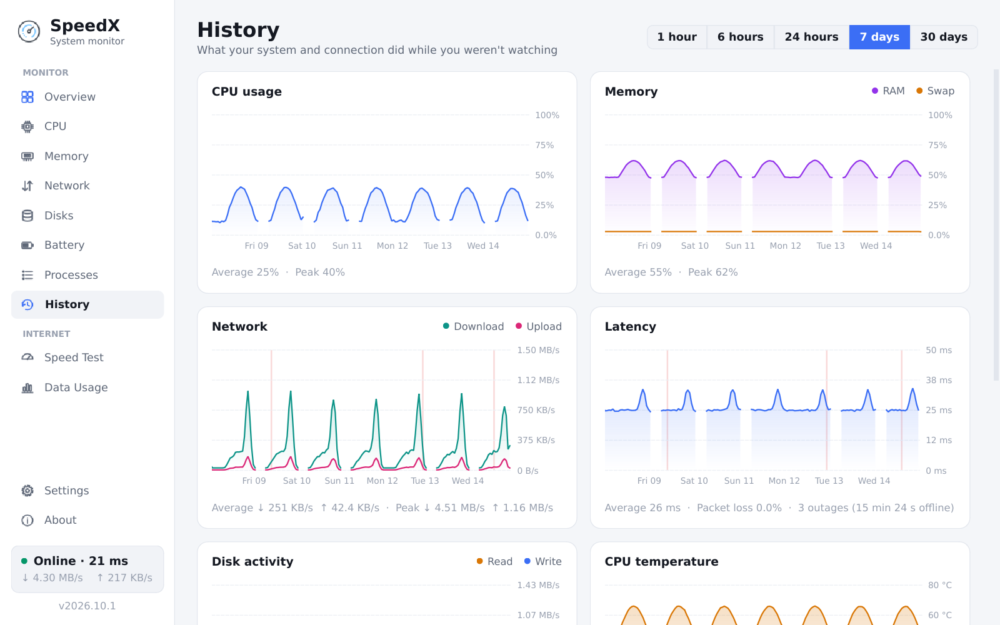
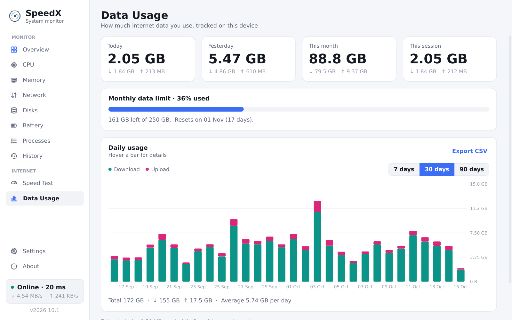

# SpeedX

**SpeedX** is a fast, lightweight **internet speed test, network monitor and system monitor** for Linux.

## Screenshots

| | |
|---|---|
|  |  |
|  |  |
|  | |

## Features

- **Overview dashboard**: CPU, memory, download and upload speed at a glance, with live graphs, top processes and storage.
- **Internet speed test**: measures real download, upload, ping and jitter, and tells you what your connection can handle. It uses Cloudflare, falling back to the nearest LibreSpeed server if Cloudflare is unreachable.
  - **Automatic tests**: optional light tests (about 50 MB each) every 1–24 hours. They're skipped on metered connections, near your data limit, on low battery and while you're busy downloading. You get an alert when your speed drops below half of normal.
  - **Speed over time**: a chart of your results over 7, 30 or 90 days with typical and slowest speeds. Export it as CSV to send to your ISP.
- **Network monitor**: separate download and upload speeds, per-interface selection, session totals and peak speeds.
- **Connection quality**: latency, jitter and packet loss measured with a ping every 2 seconds, plus a plain-language rating (for example "Good: smooth browsing, streaming and video calls").
- **Outage log**: records every time your internet goes down (start, end, duration, and whether your Wi-Fi or cable dropped or the internet itself was unreachable), with notifications when the connection drops and when it comes back.
- **Wi-Fi details**: network name, signal strength (dBm and %), 2.4/5/6 GHz band and channel, link rate, and tips when the signal is weak.
- **CSV export** for speed tests, daily data usage and the outage log.
- **Data usage tracker**: daily and monthly usage with a 7, 30 or 90 day chart, plus an optional monthly data limit with a billing day and warnings at 80% and 100%. Traffic used while SpeedX is closed is filled in the next time it starts. Only physical adapters are counted, so container and VPN traffic isn't counted twice.
- **CPU**: total and per-core usage, frequency, temperature (read from real sensors), load average and uptime.
- **Memory**: RAM and swap usage, a breakdown of available and cached memory, and the top memory consumers.
- **Disks**: free space on every volume, plus live read and write speed.
- **History**: 30 days of CPU, memory, network, latency, disk, temperature and battery history (1 hour to 30 days views), with internet outages marked.
- **Battery**: charge, status (including charge-limit detection), time remaining, power draw, battery health and charge cycles.
- **Process manager**: processes grouped by app (all of Chrome's helpers under "Google Chrome"), with search, sorting by CPU or memory, and ending a whole app or a single process.
- **Mini meter**: a small always-on-top speed meter you can drag anywhere (Ctrl+M).
- **Live speed in the top bar / system tray**: on Ubuntu, GNOME, XFCE and MATE the speed appears as text next to the icon (for example `↓ 1.2 MB/s  ↑ 340 KB/s`). You can show download and upload, download only, the combined speed, or speed plus CPU and RAM. KDE and other trays show the speed inside the icon instead. SpeedX keeps running in the background when you close the window.
- **Desktop alerts**: warnings for high CPU, high memory, CPU temperature and your data limit.
- **Launch at login**, plus **dark, light and follow-system themes**.

Keyboard shortcuts: `Ctrl+1` … `Ctrl+9` switch pages, `Ctrl+M` toggles the mini meter, `Ctrl+,` opens settings and `Ctrl+Q` quits.

## Install

**Snap**

[](https://snapcraft.io/speedx)

```
snap install speedx
```

Some features need permissions that the Snap Store may not connect automatically:

```
sudo snap connect speedx:hardware-observe   # CPU temperature and battery details
sudo snap connect speedx:system-observe     # process list
sudo snap connect speedx:mount-observe      # disk volumes
sudo snap connect speedx:process-control    # ending processes
sudo snap connect speedx:network-manager-observe   # Wi-Fi name, signal and band
```

## Run from source

Requires Python 3.8+, PyQt5, psutil and jeepney (jeepney is optional and enables the top bar text label).

```
pip install PyQt5 psutil jeepney
python3 src/speedx.py
```

## Project layout

```
src/
  speedx.py               launcher
  speedx_app/
    app.py                bootstrap, single instance handling
    main_window.py        sidebar and page navigation, tray, mini meter wiring
    monitor.py            background sampler thread and chart history
    system.py             sensors, disks, interfaces, latency probe
    speedtest.py          speed test engine (Cloudflare endpoints)
    usage.py              persistent data usage and speed test history
    alerts.py             desktop notifications
    connectivity.py       ping, packet loss, jitter and outage detection
    netinfo.py            Wi-Fi / Ethernet link details (NetworkManager)
    history_store.py      30 day per-minute history (SQLite)
    scheduler.py          automatic speed tests
    battery.py            battery details from sysfs
    apps.py               maps processes to desktop apps (systemd scopes)
    export.py             CSV export
    tray.py               tray controller: live speed label or icon
    sni.py                StatusNotifierItem + dbusmenu over D-Bus (top bar label)
    config.py             settings
    theme.py              dark and light palettes, style sheet
    icons.py              painted line icons
    widgets/              charts, gauges, cards, toggle switch
    pages/                one module per page
```

The speed test uses Cloudflare's public speed test service (`speed.cloudflare.com`). The app records data usage locally on your device and doesn't send it anywhere.
